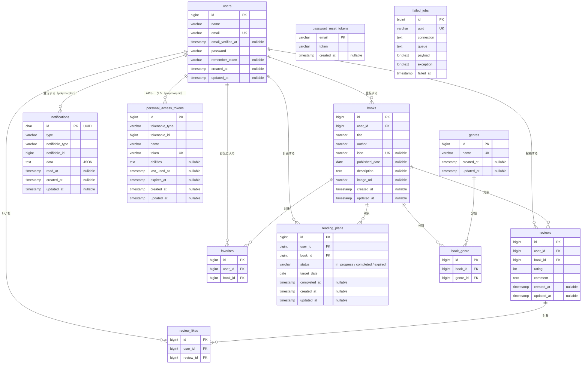

# BookShelf 書籍レビューアプリ

書籍を登録し、ジャンルで整理し、レビュー・お気に入り・いいねで共有する Web アプリケーションです。
応用機能として、検索・ISBN 自動入力・読書計画とリマインダー通知・マイ読書レポート・公開 API（Sanctum 認証）を備えます。

- 開発環境 URL: http://localhost
- phpMyAdmin: http://localhost:8080
- 作成者: nanashi

## 概要

### 基本機能

| 機能 | 内容 |
| --- | --- |
| 会員登録・ログイン | Laravel Fortify |
| 書籍 | 一覧（10 件 / ページ）・詳細・登録・編集・削除。編集・削除は作成者本人のみ |
| ジャンル | 一覧（書籍数付き）・詳細・登録・編集・削除。書籍が紐付くジャンルは削除不可 |
| レビュー | 投稿・編集・削除（投稿者本人のみ）。評価 1〜5 とコメント |
| いいね | レビューへのいいねトグル（自分のレビューには不可） |
| お気に入り | 書籍のお気に入りトグルと一覧 |
| ランキング | レビュー平均評価の TOP10 |
| 公開 API | 書籍の一覧・詳細・登録・更新・削除（JSON） |

### ★ 応用機能

| 機能 | 内容 |
| --- | --- |
| 書籍一覧の検索 | キーワード・ジャンル絞り込み・並び順。条件はページネーションに引き継ぐ |
| ISBN 検索 | 書籍登録・編集画面で 13 桁の ISBN から Google Books API の情報を自動入力 |
| 書籍の任意項目 | ISBN と出版日を任意入力に変更 |
| 読書計画 | 書籍と期日を登録し、状態（進行中 / 完了 / 期限切れ）で管理。操作は所有者本人のみ |
| リマインダー通知 | 期日の 3 日前・当日・3 日後に通知。通知一覧で既読化 |
| 日次バッチ | 毎日 20 時に期日を過ぎた計画を期限切れにし、リマインダー通知を送る |
| マイ読書レポート | 総レビュー数・読了冊数・平均評価、評価分布、高評価書籍 TOP5、ジャンル別評価傾向 TOP5 |
| 公開 API の認証 | 登録・更新・削除は Sanctum の Bearer トークン必須。更新・削除は書籍の所有者のみ |

## 使用技術

| 項目 | 内容 |
| --- | --- |
| 言語 / フレームワーク | PHP 8.5 / Laravel 10 |
| データベース | MySQL 8.4 |
| 認証 | Laravel Fortify（Web）、Laravel Sanctum（API トークン） |
| フロントエンド | Blade、Tailwind CSS 3.4、Vite 5 |
| 外部 API | Google Books API |
| 開発環境 | Docker、Laravel Sail、phpMyAdmin |
| 品質 | Laravel Pint、PHPUnit |

## 環境構築手順

Docker Desktop（Windows の場合は WSL2 バックエンド）が動作していることが前提です。

### 1. リポジトリを取得する

```bash
git clone git@github.com:syosinsyananasi/coachtech-bookshelf.git
cd coachtech-bookshelf
```

### 2. 環境設定ファイルを用意する

```bash
cp .env.example .env
```

DB 設定は Sail 用の値が入っているので、そのままで動作します。`GOOGLE_BOOKS_API_KEY` は任意です（後述）。

### 3. Composer の依存パッケージを入れる

PHP が未インストールの場合は Docker で実行できます。依存解決にのみ使う一時コンテナです。アプリ本体は手順 4 以降の PHP 8.5 コンテナで動作します。

```bash
docker run --rm \
    -u "$(id -u):$(id -g)" \
    -v "$(pwd):/var/www/html" \
    -w /var/www/html \
    laravelsail/php84-composer:latest \
    composer install --ignore-platform-reqs
```

### 4. コンテナを起動し、アプリを初期化する

```bash
./vendor/bin/sail up -d
./vendor/bin/sail artisan key:generate
./vendor/bin/sail artisan migrate --seed
```

初回起動直後は MySQL の準備が終わっておらず `SQLSTATE[HY000] [2002]` が出ることがあります。その場合は数十秒待ってから `migrate --seed` を再実行してください。
投入し直す場合は `./vendor/bin/sail artisan migrate:fresh --seed` を使ってください。

### 5. フロントエンドをビルドする

```bash
./vendor/bin/sail npm install
./vendor/bin/sail npm run build
```

### 6. ブラウザで開く

http://localhost を開き、下記のシードユーザーでログインできれば完了です。

| 名前 | メールアドレス | パスワード |
| --- | --- | --- |
| 山田太郎 | yamada@example.com | password |
| 鈴木花子 | suzuki@example.com | password |
| 田中一郎 | tanaka@example.com | password |
| 佐藤美咲 | sato@example.com | password |
| 高橋健太 | takahashi@example.com | password |

> 以下の手順は `sail` を `./vendor/bin/sail` のエイリアスとして記載します。

### Google Books API キー（任意）

ISBN 検索はキー無しでも動作します。キー無しの問い合わせは Google 側の共有上限で数えられるため、上限超過時は画面に「API通信エラーが発生しました。」と表示されます。自分専用の上限にしたい場合は、Google Cloud で Books API のキーを発行し `.env` の `GOOGLE_BOOKS_API_KEY` に設定してください。

## 動作確認手順

### 読書計画

シーダーは山田太郎に 5 件、鈴木花子に 1 件の計画を投入します。期日は投入日を基準に動的に決まります。

| 計画 | 期日 | 状態 | 確認したいこと |
| --- | --- | --- | --- |
| 1 | 3 日後 | 進行中 | バッチで「3 日前」通知の対象 |
| 2 | 当日 | 進行中 | バッチで「当日」通知の対象 |
| 3 | 3 日前 | 進行中 | バッチで期限切れになり、同時に「3 日後」通知の対象 |
| 4 | 7 日後 | 進行中 | 通知の対象外 |
| 5 | 10 日前 | 完了 | 完了済みは変更されない |
| 6（鈴木花子） | 5 日後 | 進行中 | 山田太郎で /reading-plans/6/edit を直接開くと 403 |

### 日次バッチ

バッチは `app/Console/Kernel.php` で毎日 20 時（Asia/Tokyo）に登録しています。開発環境（Sail）には cron が無いため、次のどちらかで確認してください。

バッチ本体を直接実行する:

```bash
sail artisan reading-plans:process
```

スケジュール登録を確認し、スケジュール経由で即時実行する:

```bash
sail artisan schedule:list
sail artisan schedule:test --name=reading-plans:process
```

実行後、山田太郎でログインすると通知一覧（/notifications）に 3 通が届き、読書計画一覧で計画 3 が「期限切れ」になります。同じ日に何度実行しても通知は二重に送られません。初期状態へ戻すには `sail artisan migrate:fresh --seed` を実行してください。

### 公開 API

一覧・詳細は認証なしで呼べます。

```bash
curl http://localhost/api/v1/books
curl http://localhost/api/v1/books/1
```

登録・更新・削除には Bearer トークンが必要です。トークン発行用の API は設けていないため、確認時は tinker で発行してください。

```bash
sail artisan tinker --execute='echo App\Models\User::first()->createToken("api")->plainTextToken;'
```

```bash
curl -X POST http://localhost/api/v1/books \
  -H "Authorization: Bearer （発行したトークン）" -H "Accept: application/json" -H "Content-Type: application/json" \
  -d '{"title":"テスト","author":"著者","isbn":"9780000000001","published_date":"2026-01-01","genres":[1]}'
```

## API エンドポイント一覧

| メソッド | パス | 概要 | 認証 | 成功時 |
| --- | --- | --- | --- | --- |
| GET | /api/v1/books | 書籍一覧（keyword / genre_id / page / per_page） | 不要 | 200 |
| GET | /api/v1/books/{book} | 書籍詳細（ジャンル・レビュー含む） | 不要 | 200 |
| POST | /api/v1/books | 書籍登録 | Bearer トークン | 201 |
| PUT | /api/v1/books/{book} | 書籍更新 | Bearer トークン + 所有者 | 200 |
| DELETE | /api/v1/books/{book} | 書籍削除 | Bearer トークン + 所有者 | 204 |

エラー時: 未認証 401、所有者以外 403、存在しない ID 404、バリデーションエラー 422。

## ER 図

実際のスキーマから起こしています。Laravel が内部管理に使う `migrations` テーブルは省略しています。



複合一意制約: `book_genre(book_id, genre_id)`、`favorites(user_id, book_id)`、`review_likes(user_id, review_id)`
`notifications` と `personal_access_tokens` はポリモーフィック関連（`notifiable_type` / `tokenable_type`）で、DB 上の外部キー制約はありません。

## テスト

```bash
sail artisan test
sail artisan test --coverage
sail bin pint --test
```

## ディレクトリ構成（主要）

```
app/
├── Console/Commands/    # 日次バッチ
├── Enums/
├── Http/Controllers/    # Web と Api/V1
├── Http/Requests/       # FormRequest
├── Http/Resources/      # API Resource
├── Models/
├── Notifications/
├── Policies/
└── Services/            # Google Books 連携、レポート集計
database/seeders/
tests/Feature/
```
